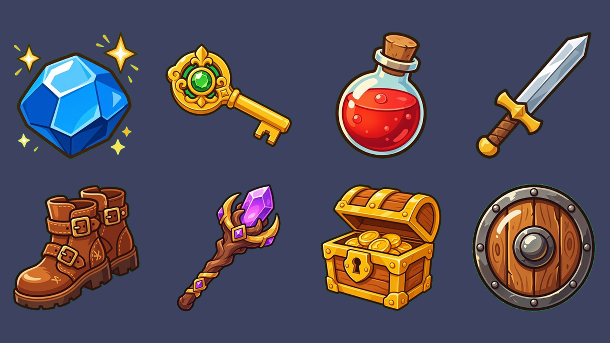

# game_icon_generator

An agent skill for making sets of cartoon game icons with [Pollinations](https://pollinations.ai).
Same style for the whole set, transparent background, square PNGs.



The first models I tried gave icons that looked like redrawn emoji. `mai-image-2.7-flash` draws things you can read at a glance, so the skill is built around it.

## What's in the repo

- `skills/game-icon-generator/` is the skill itself: `SKILL.md` for the agent, plus two scripts.
  - `make_icon.py` draws one icon or a whole set from a JSON file, cuts the green background out, and resizes.
  - `contact_sheet.py` puts a folder of icons on one sheet so you can check them together.
- `examples/` has the eight icons from the picture above and the JSON they were made from.

## Install

Copy `skills/game-icon-generator` into the skills folder of your agent. For Claude Code that is `.claude/skills/`.
Then ask for icons: "make a set of 20 item icons for my game, subjects are in items.json".

You can also run the scripts without an agent:

```
pip install pillow numpy
export POLLINATIONS_API_KEY=sk_...
python skills/game-icon-generator/scripts/make_icon.py --batch examples/icons.json -d icons/ --seed 5
python skills/game-icon-generator/scripts/contact_sheet.py icons/ -o sheet.png
```

## Notes

- About 0.0045 pollen per icon, around 12 requests a minute. A set of 30 takes a few minutes.
- The background cut-out is a flood fill from the image edges, so it works only on a flat background color.
  The default style asks for green.
- Check the rules of your platform before you upload generated images.

## License

MIT, see `LICENSE`.

[](https://pollinations.ai)
